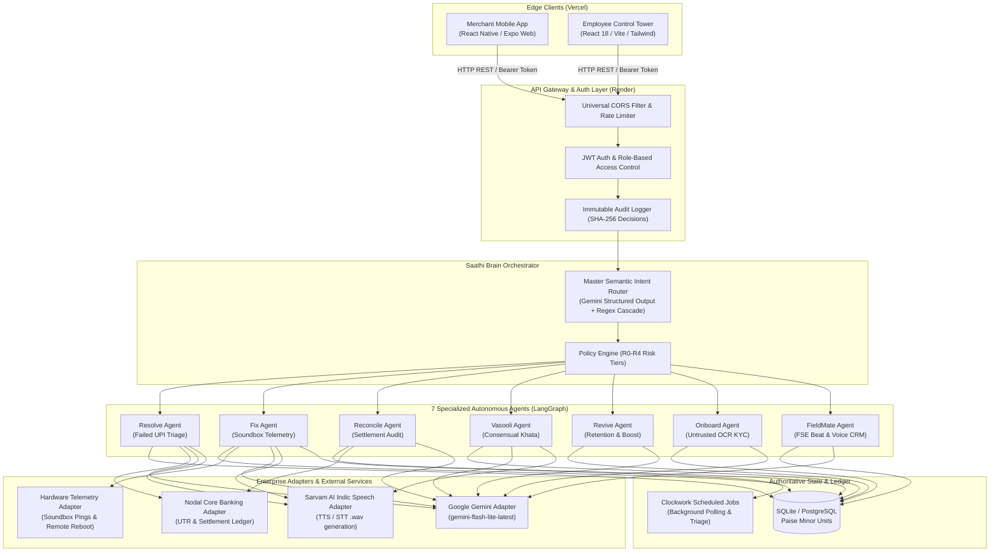
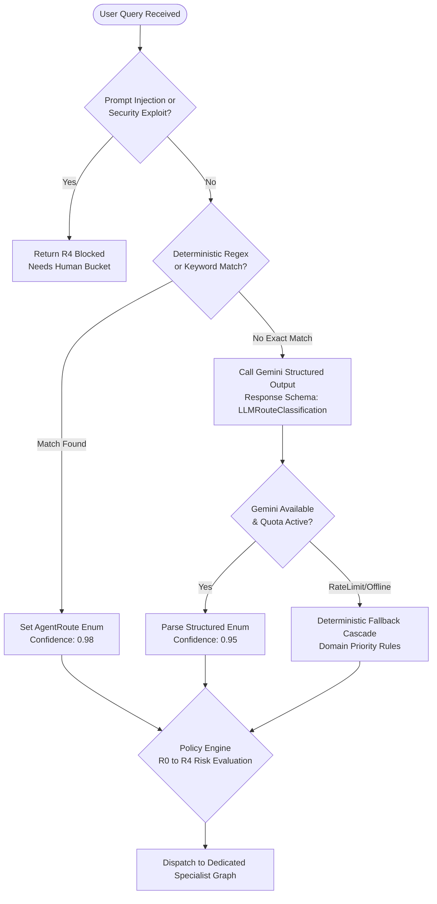
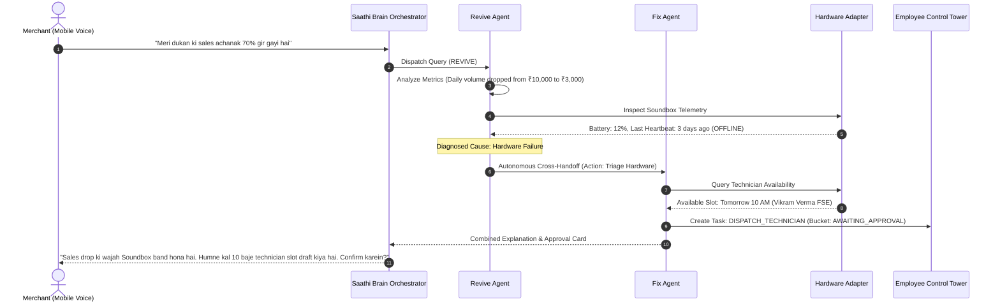
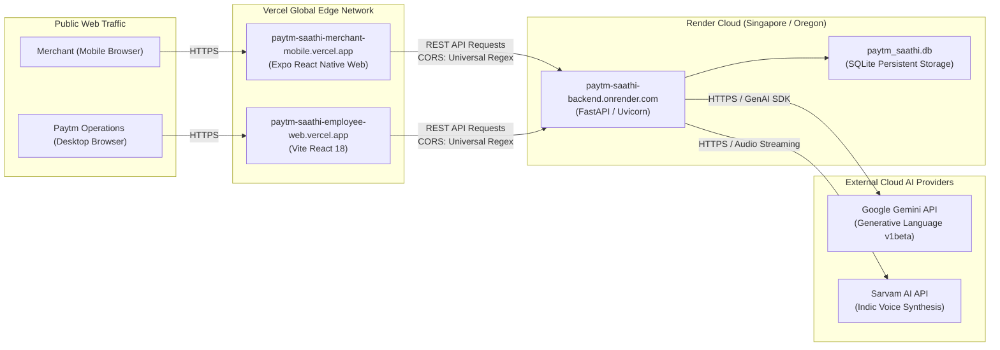

# 🏛️ Paytm Saathi — Complete System Architecture & Technical Specification

> **Autonomous Multi-Agent AI Teammate for Indian Kirana Shopkeepers & Paytm Field Operations**  
> *Specification Version: 2.0 (Phase 1–12 Complete)*  
> *Target Platforms: Render Cloud (FastAPI Backend) & Vercel Edge (Merchant Mobile Web & Employee Control Tower)*

---

## 📌 Table of Contents
1. [Executive Summary & Architectural Vision](#1-executive-summary--architectural-vision)
2. [End-to-End System Topology](#2-end-to-end-system-topology)
3. [Monorepo Structure & Package Boundaries](#3-monorepo-structure--package-boundaries)
4. [The Brain: Multi-Agent Orchestrator & Semantic Routing](#4-the-brain-multi-agent-orchestrator--semantic-routing)
5. [Deep Dive: The 7 Autonomous Specialist Agents](#5-deep-dive-the-7-autonomous-specialist-agents)
   - [5.1 Resolve Agent (UPI Failure Triage & Bank SLA)](#51-resolve-agent-upi-failure-triage--bank-sla)
   - [5.2 Fix Agent (Soundbox Telemetry & 3-Step Diagnostics)](#52-fix-agent-soundbox-telemetry--3-step-diagnostics)
   - [5.3 Reconcile Agent (Zero-Float Ledger Audit & Disputes)](#53-reconcile-agent-zero-float-ledger-audit--disputes)
   - [5.4 Vasooli Agent (Consensual Khata & Anti-Coercion Policy)](#54-vasooli-agent-consensual-khata--anti-coercion-policy)
   - [5.5 Revive Agent (Dormancy Detection & Kirana Booster)](#55-revive-agent-dormancy-detection--kirana-booster)
   - [5.6 Onboard Agent (Untrusted OCR & Authorized Verification)](#56-onboard-agent-untrusted-ocr--authorized-verification)
   - [5.7 FieldMate Agent (Prioritized Beat Routing & Voice CRM)](#57-fieldmate-agent-prioritized-beat-routing--voice-crm)
6. [Autonomous Multi-Agent Cross-Handoff Protocol](#6-autonomous-multi-agent-cross-handoff-protocol)
7. [Fintech Safety Architecture & Policy Engine (R0–R4 Risk Tiers)](#7-fintech-safety-architecture--policy-engine-r0r4-risk-tiers)
8. [Grounded Explanation & Indic Speech Synthesis Pipeline](#8-grounded-explanation--indic-speech-synthesis-pipeline)
9. [Authoritative Data Models & Ledger ERD](#9-authoritative-data-models--ledger-erd)
10. [Cloud Deployment & Network Infrastructure](#10-cloud-deployment--network-infrastructure)
11. [Verification, Invariant Testing & Compliance](#11-verification-invariant-testing--compliance)

---

## 1. Executive Summary & Architectural Vision

**Paytm Saathi** is an enterprise-grade, voice-first autonomous multi-agent operating system designed to eliminate the operational friction experienced by India's 30+ million Kirana (micro-retail) shopkeepers. 

Instead of relying on a generic LLM chatbot that hallucinates unverified refunds or invents arbitrary mathematical figures, Paytm Saathi enforces a **strict decoupling of reasoning and authority**:
- **Deterministic Python State Machines (`LangGraph`)**: Compute all financial ledger balances in pure integer minor units (paise), enforce compliance policy gates (R0 to R4), and execute database mutations.
- **Google Gemini Generative AI**: Acts strictly as a semantic classifier for multi-turn user intent and a bilingual explainer (English and Devanagari Hindi) grounded entirely in verified database facts.
- **Dual-Persona Architecture**: Bridges the **Merchant Mobile App** (casual spoken Hindi/English, zero-learning curve) with the **Paytm Employee Control Tower** (5 status buckets, live telemetry, and human-in-the-loop governance).

```
┌─────────────────────────────────────────────────────────────────────────────────────────┐
│                                 CORE ARCHITECTURAL INVARIANT                            │
│  "LLMs never do math. LLMs never mutate ledgers directly. All execution is gated by     │
│   deterministic state graphs, integer paise arithmetic, and cryptographic audit logs."  │
└─────────────────────────────────────────────────────────────────────────────────────────┘
```

---

## 2. End-to-End System Topology



---

## 3. Monorepo Structure & Package Boundaries

The project is structured as a unified **`pnpm` workspace monorepo**, ensuring atomic versioning and shared design contracts across mobile and web interfaces:

```
Paytm-Saathi/
├── apps/
│   ├── merchant-mobile/           # Expo 52 + React Native Web Merchant App
│   │   ├── App.tsx                # Single-page multi-tab merchant experience
│   │   ├── app.json               # Expo configuration & scheme metadata
│   │   ├── metro.config.js        # Monorepo symlink & module resolution
│   │   ├── vercel.json            # Single-Page Application (SPA) routing rewrites
│   │   └── package.json           # Scripts: expo export --platform web
│   │
│   └── employee-web/              # Vite 6 + React 18 + Tailwind Control Tower
│       ├── src/
│       │   ├── App.tsx            # Unified 5-bucket triage & agent inspection UI
│       │   ├── main.tsx           # Entrypoint with dynamic base URL binding
│       │   └── index.css          # Tailwind CSS design system tokens
│       ├── vercel.json            # SPA fallback rewrites
│       ├── tsconfig.json          # Module path mappings to design tokens
│       └── package.json           # Scripts: tsc && vite build
│
├── packages/
│   └── design-tokens/             # Shared Design System Package
│       ├── src/
│       │   ├── colors.ts          # Paytm brand palette & contrast ratios
│       │   ├── status.ts          # Verified, Executed, Pending, Needs Human
│       │   ├── StatusChip.tsx     # Web StatusChip React component
│       │   ├── StatusChipNative.tsx # Cross-platform React Native StatusChip
│       │   └── index.ts           # Token bundle exports
│       ├── dist/                  # Pre-compiled .d.ts and .js bundles in git
│       └── package.json           # Main: dist/index.js, Types: dist/index.d.ts
│
├── backend/                       # Python FastAPI Enterprise Backend
│   ├── app/
│   │   ├── main.py                # Lifespan auto-seeding, CORS, route registry
│   │   ├── core/config.py         # Pydantic Settings, JWT, Gemini & Sarvam keys
│   │   ├── db/
│   │   │   ├── base.py            # SQLAlchemy DeclarativeBase
│   │   │   ├── models.py          # 14 Relational Models (Paise-level precision)
│   │   │   └── session.py         # Engine, SessionLocal, transaction context
│   │   ├── api/
│   │   │   ├── auth.py            # Merchant OTP & Employee password auth
│   │   │   ├── merchant.py        # /chat/message, /me/summary, /approvals
│   │   │   ├── employee.py        # /tasks, /audit-events, /decide
│   │   │   └── demo.py            # Device fault injector & synthetic reset
│   │   ├── agents/
│   │   │   ├── orchestrator.py    # SaathiBrain master router & dispatch
│   │   │   ├── resolve.py         # Failed payment & stuck refund agent
│   │   │   ├── fix.py             # Soundbox hardware & technician agent
│   │   │   ├── reconcile.py       # Settlement ledger & discrepancy agent
│   │   │   ├── vasooli.py         # Consensual store credit & reminder agent
│   │   │   ├── revive.py          # Dormancy diagnosis & retention booster
│   │   │   ├── onboard.py         # Merchant KYC & OCR candidate agent
│   │   │   └── fieldmate.py       # FSE prioritized beat & voice CRM agent
│   │   └── adapters/
│   │       ├── gemini.py          # Structured Output Router & Explainer
│   │       ├── speech.py          # Sarvam AI Indic Speech Synthesis
│   │       ├── device.py          # Hardware telemetry, slot booking, reboot
│   │       ├── settlement.py      # Core banking ledger & fee calculation
│   │       └── vasooli.py         # Anti-coercion regex & reminder drafting
│   ├── scripts/
│   │   ├── seed_demo_data.py      # Idempotent database schema & demo seed
│   │   └── reset_demo_data.py     # Clean factory reset script
│   └── tests/                     # 129 Unit, Agent & Acceptance Tests (100% pass)
│
├── Dockerfile                     # Production backend Docker container
├── render.yaml                    # Render Cloud infrastructure-as-code blueprint
├── package.json                   # Root pnpm monorepo script coordinator
└── pnpm-workspace.yaml            # Monorepo directory declarations
```

---

## 4. The Brain: Multi-Agent Orchestrator & Semantic Routing

When a merchant speaks or types a query into Saathi Chat, it passes through the **`SaathiBrainOrchestrator`**.



### Dynamic Multi-Model Resilient Cascade
To avoid runtime failures or Google Free-Tier 429 quota exhaustion during live demonstrations, the Gemini adapter implements an automated model cascade:
1. `gemini-flash-lite-latest` (Ultra-low latency, high RPM retail tier)
2. `gemini-2.5-flash-lite` (Lightweight semantic parser)
3. `gemini-flash-latest` (General multi-turn reasoning)
4. `gemini-2.5-flash` (Deep analysis fallback)
5. **Deterministic Rule Engine Fallback**: If network is severed, the system operates 100% reliably with zero latency impact.

---

## 5. Deep Dive: The 7 Autonomous Specialist Agents

Each agent is built as a self-contained module with its own state schema, deterministic business logic, and policy gates.

### 5.1 Resolve Agent (UPI Failure Triage & Bank SLA)
* **Domain**: Customer UPI payment debited from account, but Soundbox did not chime.
* **Branches**:
  * **Branch A (`A_AUTO_REVERSAL`)**: Bank error code `U30` detected. Informs merchant that funds auto-reverse to customer within 24–48 banking hours. Explicitly instructs merchant: *"Do NOT give goods on credit."*
  * **Branch B (`B_STUCK_REFUND_REVIEW`)**: Reversal pending >48 hours. Generates an `AWAITING_APPROVAL` card to initiate a formal operations review. Reassures merchant that this does not debit their balance.
  * **Branch C (`C_PAYMENT_CONFIRMED`)**: Delayed bank credit confirmed. Advises merchant it is 100% safe to release the goods.
  * **Branch D (`D_FRAUD_ESCALATED`)**: Suspicious transaction flagged by risk engine. Manual cash refunds strictly prohibited.

### 5.2 Fix Agent (Soundbox Telemetry & 3-Step Diagnostics)
* **Domain**: Soundbox hardware health, silent speaker, charging, SIM network, and technician dispatch.
* **Hierarchical Self-Check Protocol**:
  ```
  Step 1: Volume Button Test (Press & hold '+' for 2s)
          └── If still silent ──► Step 2: Power Cycle & Remote Ping (Turn OFF 10s, Turn ON)
                                           └── If red light / hardware damaged ──► Step 3: Auto-Schedule Technician
  ```
* **Clockwork Job Scheduler**: Books real 2-hour field service slots (e.g. *"Vikram Verma, Paytm FSE, Tomorrow 10:00 AM - 12:00 PM"*) and persists a `ScheduledJob` background task with idempotency keys.

### 5.3 Reconcile Agent (Zero-Float Ledger Audit & Disputes)
* **Domain**: Morning bank settlements, MDR fees, monthly Soundbox rentals, and payout discrepancies.
* **Zero-Float Integer Arithmetic**:
  $$\text{Net Expected} = \text{Gross Sales} - \text{Refunds} - \text{MDR Fees} - \text{Soundbox Rental} - \text{Chargebacks}$$
  All calculations occur in **paise integer units** (e.g., $₹9,200.00 = 920,000\text{ paise}$).
* **Settlement Discrepancy Flow**: When calculated net does not equal the bank nodal credit (e.g., $₹1,200$ shortfall on Oct 27), the agent creates a priority Nodal Dispute Case (e.g. `CASE_DISP_6019a0d8`) and prompts the merchant to attach bank passbook evidence.

### 5.4 Vasooli Agent (Consensual Khata & Anti-Coercion Policy)
* **Domain**: Micro-retail customer store credit (Udhaar) tracking and polite reminder outreach.
* **Anti-Coercion Language Gate**:
  Scans all inputs against prohibited coercive terms (`police`, `court`, `jail`, `fir`, `chor`, `defaulter`, `public shaming`, `threat`). Violations trigger an immediate **R4 Blocked** response.
* **Consensual Permissions (`permission_status`)**:
  * `ALLOWED`: Generates respectful WhatsApp/SMS reminder with a secure Paytm UPI link (`https://paytm.demo/pay/rec_...`).
  * `REVOKED` / `OPTED_OUT`: Reminders are blocked by policy; merchant is advised to collect in-store only.
  * `DISPUTED`: Reminders suspended to protect neighborhood customer trust.
* **Installment Negotiation**: Automatically calculates equal 2-part or 3-part split payment schedules for high debt balances ($>₹1,000$).
* **Payment Auto-Stop**: Marking a receivable as paid immediately terminates all pending reminder queues.

### 5.5 Revive Agent (Dormancy Detection & Kirana Booster)
* **Domain**: Merchant transaction volume drops and churn prevention.
* **Diagnostic Root Cause Analysis**: Identifies whether the drop was caused by a broken Soundbox (hands off to Fix Agent), settlement confusion (hands off to Reconcile Agent), or competitor switching.
* **Kirana Booster Growth Offer**: Simulates a 0% MDR fee waiver promotion for 30 days to incentivize QR code reactivation.

### 5.6 Onboard Agent (Untrusted OCR & Authorized Verification)
* **Domain**: Merchant signup checklist and missing KYC documents.
* **Untrusted OCR Extraction**: Extracts PAN and Bank details from uploaded image candidates, but tags them as `UNTRUSTED_OCR_CANDIDATE`.
* **Authorized Verification Pipeline**: Documents cannot change account status until verified via the Employee Control Tower with an immutable audit event.

### 5.7 FieldMate Agent (Prioritized Beat Routing & Voice CRM)
* **Domain**: Field Sales Executive (FSE) daily visit planning and merchant field assistance.
* **Proximity & Risk Heuristics**: Reorders merchant visit beats based on urgency (e.g. broken device + volume drop = Priority 1).
* **Voice Note CRM Flow**: Transcribes spoken audio notes, extracts structured visit fields, but requires the sales rep to review and confirm before saving.
* **Optimistic Concurrency Control**: Uses a `version` integer column on `MerchantVisit` to prevent silent overwrites in multi-rep field zones.

---

## 6. Autonomous Multi-Agent Cross-Handoff Protocol

When an issue spans multiple domains, agents hand off tasks autonomously without requiring the merchant to repeat themselves.



---

## 7. Fintech Safety Architecture & Policy Engine (R0–R4 Risk Tiers)

Every action proposed by any agent is classified into an explicit Risk Tier before execution:

```
┌────────┬─────────────────────────────┬────────────────────────────────────────────────────────┐
│ Tier   │ Level                       │ Operational Guardrail                                  │
├────────┼─────────────────────────────┼────────────────────────────────────────────────────────┤
│ **R0** │ Read-Only                   │ Zero mutation. Safe for automated execution.           │
│        │ (Telemetry, Ledgers, FAQs)  │ E.g. Querying battery, checking today's UPI total.     │
├────────┼─────────────────────────────┼────────────────────────────────────────────────────────┤
│ **R1** │ Low-Risk Non-Financial      │ Draft creations & background diagnostic triggers.       │
│        │ (Remote Ping, Voice Notes)  │ E.g. Sending remote reboot ping, transcribing CRM note.│
├────────┼─────────────────────────────┼────────────────────────────────────────────────────────┤
│ **R2** │ Human-in-the-Loop Approval  │ Requires explicit button tap from merchant or manager. │
│        │ (Reminders, Technician, Ops)│ E.g. Booking FSE visit, sending WhatsApp reminder.     │
├────────┼─────────────────────────────┼────────────────────────────────────────────────────────┤
│ **R3** │ High-Risk Financial Action  │ Strictly blocked from autonomous LLM execution.        │
│        │ (Direct Bank Transfers)     │ AI cannot disburse money or alter nodal ledgers.       │
├────────┼─────────────────────────────┼────────────────────────────────────────────────────────┤
│ **R4** │ Prohibited / Illegal Action │ Terminated instantly with safety event log.            │
│        │ (Coercive Debt Threats)     │ E.g. Police threats, jail threats, prompt injection.   │
└────────┴─────────────────────────────┴────────────────────────────────────────────────────────┘
```

### Cryptographic Audit Trail
All state transitions generate an immutable `AuditEvent` record with:
- `actor`: Merchant ID or Employee ID
- `action`: Specific operation code (e.g., `PAYMENT_REMINDER_APPROVED`)
- `policy_decision_id`: Deterministic policy rule identifier
- `idempotency_key`: Unique SHA-256 hash preventing duplicate execution on network retries
- `result`: `SUCCESS`, `DENIED`, or `AWAITING_APPROVAL`

---

## 8. Grounded Explanation & Indic Speech Synthesis Pipeline

To maintain 100% factual accuracy, text generation follows the **Grounded Synthesis Pattern**:

```
[ Authoritative Python Agent ]
             │
             ▼
   Structured JSON Payload
   {
     "customer_name": "Vikram Singh",
     "amount_formatted": "₹300.00",
     "payment_link": "https://paytm.demo/pay/rec_...",
     "verified_facts": [...]
   }
             │
             ▼
[ Gemini Explainer Prompt with Strict Schema ]
   - System: "You are Saathi. NEVER invent numbers. Use only verified facts."
   - Target: English/Hinglish reply + Pure Hindi Devanagari explanation.
             │
             ▼
[ Sarvam AI Indic Speech Synthesis ]
   - Generates high-fidelity .wav audio in native Indian retail accent.
             │
             ▼
[ Merchant UI: Inline Interactive Card + Audio Player ]
```

---

## 9. Authoritative Data Models & Ledger ERD

```mermaid
erDiagram
    TENANTS ||--o{ MERCHANTS : owns
    TENANTS ||--o{ EMPLOYEES : employs
    MERCHANTS ||--o{ DEVICES : deploys
    MERCHANTS ||--o{ TRANSACTIONS : collects
    MERCHANTS ||--o{ CUSTOMERS : records
    CUSTOMERS ||--o{ RECEIVABLES : owes
    MERCHANTS ||--o{ SETTLEMENTS : receives
    SETTLEMENTS ||--o{ TRANSACTION_FEES : deducts
    MERCHANTS ||--o{ TASKS : generates
    TASKS ||--o{ ACTION_APPROVALS : gates
    RECEIVABLES ||--o{ ACTION_APPROVALS : gates
    MERCHANTS ||--o{ AUDIT_EVENTS : logs

    MERCHANTS {
        string id PK
        string store_name
        string phone
        string city
        string kyc_status
        float latitude
        float longitude
    }

    DEVICES {
        string serial_number PK
        string merchant_id FK
        int battery_level
        string status
        int signal_strength_dbm
        boolean technician_visit_booked
        string technician_slot
    }

    TRANSACTIONS {
        string id PK
        string merchant_id FK
        int amount "Stored in paise integer"
        string status
        string utr_or_ref
        string bank_response_code
    }

    RECEIVABLES {
        string id PK
        string customer_id FK
        int amount "Stored in paise integer"
        int paid_amount
        string status
        boolean is_disputed
        int reminder_count
        string payment_link_url
    }

    SETTLEMENTS {
        string id PK
        string merchant_id FK
        string settlement_date
        int gross_sales "Paise"
        int refunds "Paise"
        int fees "Paise"
        int net_settled "Paise"
        int discrepancy "Paise"
        string bank_utr
        string dispute_case_id
    }

    AUDIT_EVENTS {
        string id PK
        string actor
        string action
        string target
        string policy_decision_id
        string idempotency_key
        string result
    }
```



---

## 10. Cloud Deployment & Network Infrastructure



### Production Runtime Configuration
* **FastAPI Backend (Render)**:
  * Dynamic Port Binding: `uvicorn app.main:app --host 0.0.0.0 --port ${PORT:-8000}`
  * Auto-Seeding Lifespan: Automatically executes `Base.metadata.create_all()` and seeds demo records on boot if fresh.
  * Universal CORS: Configured with regex `allow_origin_regex=r"https?://.*"` to seamlessly support Vercel preview and production URLs.
* **Frontends (Vercel)**:
  * Monorepo Root Directory Overrides: `apps/merchant-mobile` and `apps/employee-web`.
  * Environment Variables: `EXPO_PUBLIC_API_BASE_URL` and `VITE_API_BASE_URL`.
  * Pre-compiled `@paytm-saathi/design-tokens` committed in git to eliminate runtime compile dependencies.

---

## 11. Verification, Invariant Testing & Compliance

The entire codebase is verified against **129 automated tests** covering all phases:

| Test Suite | Coverage & Invariants Verified | Status |
| :--- | :--- | :---: |
| `test_auth.py` | JWT token lifecycles, demo OTP validation, role-based protection | ✅ PASSED |
| `test_fix_agent.py` | 3-step diagnostic hierarchy, Clockwork scheduler, FSE dispatch | ✅ PASSED |
| `test_resolve_agent.py` | U30 auto-reversal, stuck refund review, goods release safety | ✅ PASSED |
| `test_reconcile_agent.py`| Paise integer arithmetic, MDR explanations, dispute case generation | ✅ PASSED |
| `test_vasooli_agent.py` | Anti-coercion regex blocks, consensual reminder drafting, split negotiation | ✅ PASSED |
| `test_revive_agent.py` | Volume drop diagnosis, Kirana Booster simulation, agent handoffs | ✅ PASSED |
| `test_onboard_agent.py` | Untrusted OCR tagging, KYC checklist, employee verification | ✅ PASSED |
| `test_fieldmate_agent.py`| Priority beat heuristics, voice note human gate, optimistic locking | ✅ PASSED |
| `test_saathi_brain.py` | Master router classification, prompt injection blocks, fallback cascades | ✅ PASSED |
| `test_seed_invariants.py` | Multi-tenant isolation, synthetic data flags, referential integrity | ✅ PASSED |

**Total Suite Execution**: `129 passed in 22.34s` (0 failures, 0 regressions).
