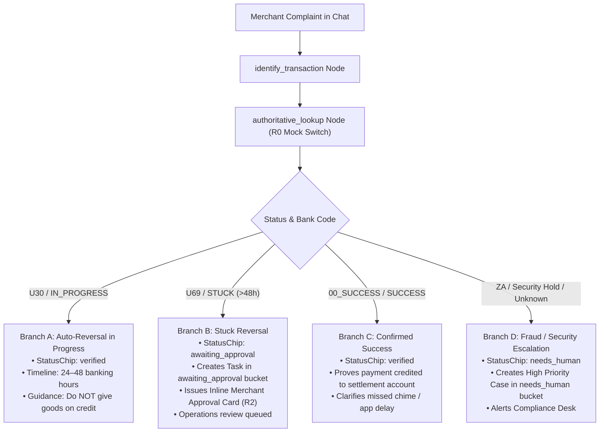

# Explanation: Phase 4 — The Resolve Agent (Failed Payment)

## 1. Overview and Problem Context
Small kirana merchants frequently encounter payment disputes when a customer's UPI app reports money debited, but the Soundbox does not announce a chime. Merchants risk double loss: either handing over goods for an unsettled transaction, or facing disputes when an auto-reversal is delayed.

The **Resolve Agent** is Saathi's first specialist agent. It operates under strict policy controls:
- **Authoritative Data Only**: The agent NEVER guesses or hallucinate status based on user conversational text. It queries the payment switch mock (`TransactionAdapter`).
- **Deterministic State Routing**: The workflow is modeled as a LangGraph state machine (`identify_transaction` → `authoritative_lookup` → `route_and_execute`).
- **Strict R3 Financial Boundaries**: Actual financial refund execution (`execute_refund`) is an R3 regulated action disabled by design. The agent can only request an operational review (`request_refund_review`, R1).

---

## 2. The Four Deterministic Branches

### Branch A: Auto-Reversal in Progress (NPCI Code `U30_AUTO_REVERSAL`)
- **Condition**: Transaction failed due to interbank switch timeout; bank auto-reversal is marked `IN_PROGRESS`.
- **Action**: Informs the merchant of the exact SLA timeline (24 to 48 banking hours).
- **Merchant Advice**: Do NOT give goods on credit; customer will receive money back automatically.

### Branch B: Stuck Reversal (NPCI Code `U69_REVERSAL_STUCK`, >48 hours)
- **Condition**: Reversal SLA has elapsed without auto-credit to customer.
- **Action**: Generates an R1 `request_refund_review` task in the `awaiting_approval` bucket.
- **Approval Card**: Merchant receives an inline approval card explaining that authorizing does NOT deduct from their balance, but queues an operations credit investigation.

### Branch C: Payment Confirmed (Bank Code `00_SUCCESS`)
- **Condition**: Customer claims payment failed, but authoritative switch records show the transaction succeeded and settled.
- **Action**: Confirms credit to the merchant's account with UTR proof. Reassures merchant that even if the chime was delayed or customer's phone glitched, funds are safe.

### Branch D: Security / Fraud Escalation (Bank Code `ZA_SECURITY_HOLD`)
- **Condition**: Mismatched terminal, suspicious VPA, or security hold.
- **Action**: Automatically escalates to `needs_human` bucket, generating a High Priority ticket for the Paytm Compliance & Risk operations team. Warns merchant not to issue cash or manual adjustments.

---

## 3. Risk-Tiered Toolset & PolicyEngine Gate

| Tool | Risk Tier | Category | Policy Behavior |
| :--- | :--- | :--- | :--- |
| `get_transaction_status` | **R0** | Read-Only | Permitted without restriction |
| `get_related_payment_events` | **R0** | Read-Only | Permitted without restriction |
| `draft_customer_explanation` | **R1** | Internal/Reversible | Formats bilingual Hindi/English customer message |
| `request_refund_review` | **R1** | Internal Task Creation | Idempotently creates `Task` and `ActionApproval` |
| `create_support_case` | **R1** | Internal Escalation | Creates ticket in `needs_human` or `pending` |
| `execute_refund` | **R3** | Regulated Financial | **BLOCKED BY POLICY ENGINE** (`allowed=False`) |

---

## 4. Front-End Implementations

### Merchant Mobile (`apps/merchant-mobile`)
1. **Interactive Saathi Chat**: Merchant describes payment issue or taps quick test chips (`₹250 Auto-Reversal`, `₹500 Stuck Reversal`, `₹320 Confirmed`, `₹1,200 Security Escalation`).
2. **Inline Status Chips**: Every Saathi response features a `StatusChipNative` rendering the exact state.
3. **Bilingual Hindi Explanations**: Collapsible/distinct card with customer-facing Hindi text ready for kirana shopkeepers to read or show customers.
4. **Interactive Approval Cards**: Inline cards for Branch B cases with "Authorize Review Request" and "Dismiss" buttons calling `POST /merchant/approvals/{id}/decide`.

### Employee Web Control Tower (`apps/employee-web`)
1. **Unified Cases Table**: Automatically reflects new refund review tasks (`awaiting_approval`) and security escalations (`needs_human`).
2. **Slide-over Timeline**: Direct inspection panel querying real `audit_events` to prove complete provenance from merchant chat to agent resolution.
